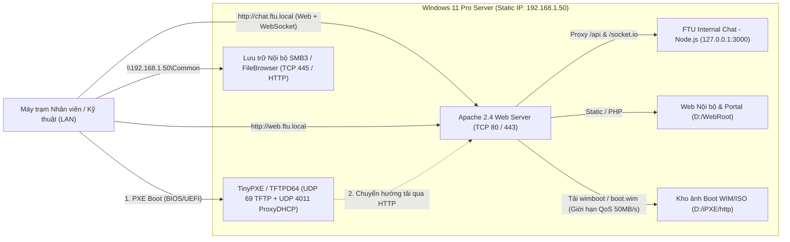

# Step-by-Step Manual Runbook: Triển khai Máy chủ Đa Vai Trò trên Windows 11 Pro (Tối ưu cho CPU Core i5 / 16GB RAM DDR3)

Tài liệu này hướng dẫn chi tiết từng bước triển khai thủ công (qua giao diện GUI và dòng lệnh) để biến máy chủ **Windows 11 Pro (Core i5, 16GB DDR3)** thành **All-in-One Internal Server** phục vụ đồng thời 4 vai trò:
1. **FTU Internal Chat Server** (Node.js v24 + Socket.io + SQLite WAL, cổng nội bộ `127.0.0.1:3000` / LAN `:3000`)
2. **Apache 2.4 Web Server & Reverse Proxy** (Cổng chuẩn `80` / `443`)
3. **iPXE Network Boot Server** (TFTP `UDP 69` + ProxyDHCP `UDP 4011` + Kho tải HTTP tốc độ Gigabit qua Apache)
4. **Internal Storage / File Server** (Lưu trữ nội bộ SMB3 `TCP 445` + Web File Server + Shadow Copies)

---

## 1. Kiến trúc tổng thể & Phân bổ Tài nguyên (Core i5 / 16GB DDR3)



### 1.1. Bảng phân bổ RAM & CPU thực tế (Chạy 100% Native Windows Services)
> **Nguyên tắc vàng trên máy i5 / 16GB DDR3**: Tuyệt đối **không** dùng máy ảo (VMware/Hyper-V) hay Docker Desktop/WSL2. Chạy thuần Native Windows Service để nhường **~13GB RAM DDR3 trống** cho Windows làm **File System Standby Cache**.

| Thành phần | Tiêu thụ RAM | Tiêu thụ CPU (i5 4 nhân) | Cổng sử dụng |
| :--- | :--- | :--- | :--- |
| **Windows 11 Pro (đã tối ưu)** | `~2.4 GB` | `1% – 3%` | Hệ điều hành nền |
| **FTU Internal Chat (`node.exe` v24)** | `~90 MB` | `< 1%` | `TCP 3000` |
| **Apache 2.4 (`httpd.exe` - `mpm_winnt`)** | `~45 MB` | `< 1%` | `TCP 80`, `TCP 443` |
| **Tiny PXE Server (`pxesrv.exe`)** | `~15 MB` | `0%` | `UDP 69`, `UDP 4011` |
| **Lưu trữ SMB3 + `filebrowser.exe`** | `~40 MB` | `1% – 4%` | `TCP 445`, `127.0.0.1:8080` |
| **Tổng cộng toàn hệ thống** | **`~2.6 GB / 16 GB`** | **`< 5%`** | **Còn dư ~13.4 GB RAM làm Cache** |

### 1.2. Sơ đồ bố trí ổ cứng SATA III (6Gbps) tối ưu
- **Cổng SATA_0 (Ổ SSD SATA 256GB – 512GB)** — chia 2 phân vùng:
  - **Ổ `C:` (120GB)**: Cài Windows 11 Pro, Node.js, Git, `C:\Apache24`, `C:\Tools`.
  - **Ổ `D:` (Phần còn lại của SSD)**:
    - `D:\Apps\internal-ftu` *(Mã nguồn + SQLite `chat.db` + `uploads/`)*
    - `D:\WebRoot` *(Mã nguồn Web nội bộ)*
    - `D:\iPXE` *(Các file `boot.wim`, `wimboot`, ISO boot mạng)*
- **Cổng SATA_1 & SATA_2 (1 hoặc 2 ổ HDD Enterprise/NAS 1TB – 4TB)**:
  - **Ổ `E:`**:
    - `E:\Shares\Common` *(Thư mục chia sẻ file nội bộ)*
    - `E:\Backups\ftu-chat` *(Chứa bản sao lưu tự động hằng đêm)*

### 1.3. Danh sách bộ cài cần tải sẵn vào `C:\Tools\Installers`
1. **Node.js v24 LTS (Windows x64 `.msi`)**: `https://nodejs.org`
2. **Git for Windows (x64 `.exe`)**: `https://git-scm.com`
3. **Visual C++ Redistributable 2015–2022 (x64)**: `vc_redist.x64.exe`
4. **Apache 2.4 Win64 (`.zip`)**: `https://www.apachelounge.com/download/` (`httpd-2.4.x-win64-VS17.zip`)
5. **NSSM (Non-Sucking Service Manager)**: `https://nssm.cc/download` (`nssm-2.24.zip`)
6. **Tiny PXE Server** (hoặc **TFTPD64**): `pxesrv.zip`
7. **Bộ nhân iPXE & Wimboot**:
   - `http://boot.ipxe.org/undionly.kpxe` *(cho máy Legacy BIOS)*
   - `http://boot.ipxe.org/ipxe.efi` *(cho máy UEFI)*
   - `https://github.com/ipxe/wimboot/releases/latest/download/wimboot`

---

## 🛠️ GIAI ĐOẠN 1: Tối ưu Hệ điều hành Windows 11 Pro cho CPU i5 & Chạy 24/7

### Bước 1.1: Đặt địa chỉ IP tĩnh (Static IP) & Chuyển mạng sang Private
1. Nhấn `Win + I` mở **Settings → Network & internet → Ethernet**.
2. Tại **Network profile type**, chọn **Private network**.
3. Tại **IP assignment**, bấm **Edit** → chọn **Manual** → bật **IPv4**:
   - **IP address**: `192.168.1.50` *(thay bằng IP tĩnh bạn chọn trong LAN)*
   - **Subnet mask**: `255.255.255.0`
   - **Gateway**: `192.168.1.1`
   - **Preferred DNS**: `192.168.1.1` (hoặc `8.8.8.8`) → **Save**.

### Bước 1.2: Tắt hoàn toàn Sleep & Hibernate
1. Nhấn `Win + R`, gõ `control powercfg.cpl` → Enter.
2. Chọn **High performance** → bấm **Change plan settings**.
3. Đặt **Turn off the display**: `Never` và **Put the computer to sleep**: `Never` → **Save changes**.
4. Bấm **Change advanced power settings**:
   - **Hard disk → Turn off hard disk after**: `0` (Never).
   - **Sleep → Sleep after**: `Never`, **Hibernate after**: `Never` → **OK**.

### Bước 1.3: Chặn Windows Update tự khởi động lại máy chủ
1. Nhấn `Win + R`, gõ `gpedit.msc` → Enter.
2. Đi tới: **Computer Configuration → Administrative Templates → Windows Components → Windows Update → Manage end user experience**.
3. Nháy đúp **Configure Automatic Updates** → chọn **Enabled** → chọn **`2 - Notify for download and auto install`** → **OK**.
4. Nháy đúp **No auto-restart with logged on users for scheduled automatic updates installations** → chọn **Enabled** → **OK**.

### Bước 1.4: Tắt 4 tác vụ ngầm gây tốn CPU trên máy Core i5 đời DDR3
1. **Tắt lập chỉ mục tìm kiếm (`Windows Search`)**:
   - Nhấn `Win + R`, gõ `services.msc` → tìm **`Windows Search`** → Chuột phải chọn **Properties** → *Startup type*: **`Disabled`** → bấm **Stop** → **OK**.
2. **Tắt hiệu ứng đồ họa Windows 11**:
   - Nhấn `Win + R`, gõ `SystemPropertiesPerformance.exe` → tích chọn **`Adjust for best performance`** → **Apply** → **OK**.
3. **Tắt nén RAM (`Memory Compression`)** (vì 16GB RAM đang dư >12GB, không cần tốn CPU i5 để nén RAM):
   - Mở **PowerShell (Run as Administrator)**, chạy:
     ```powershell
     Disable-MMAgent -MemoryCompression
     ```
4. **Tắt ứng dụng khởi động cùng Windows**:
   - Mở **Task Manager (`Ctrl + Shift + Esc`) → Startup apps**: Disable toàn bộ (`OneDrive`, `Edge`, `Teams`, `Widgets`).

### Bước 1.5: Cài đặt công cụ NSSM vào System32
1. Giải nén `nssm-2.24.zip`.
2. Copy file **`win64\nssm.exe`** dán vào **`C:\Windows\System32\`**.

---

## 💬 GIAI ĐOẠN 2: Triển khai thủ công ứng dụng FTU Internal Chat

### Bước 2.1: Cài đặt Node.js v24 LTS & Git
1. Chạy `node-v24.x.x-x64.msi` và `Git-x64.exe` với thiết lập mặc định.
2. Mở **Command Prompt (Admin)** kiểm tra:
   ```cmd
   node -v
   npm -v
   git --version
   ```

### Bước 2.2: Tải mã nguồn, Cài đặt & Build giao diện Production
Chạy lần lượt trong **Command Prompt**:
```cmd
D:
mkdir D:\Apps
cd D:\Apps
git clone https://github.com/7teen11/internal-ftu.git
cd D:\Apps\internal-ftu
```
1. **Cài đặt thư viện Backend**:
   ```cmd
   cd D:\Apps\internal-ftu\backend
   npm install
   ```
2. **Cài đặt thư viện Frontend & Build vào `backend/public`**:
   ```cmd
   cd D:\Apps\internal-ftu\frontend
   npm install
   npm run build
   ```
3. **Khởi chạy thử bằng tay lần đầu** (hệ thống sẽ tự tạo file `D:\Apps\internal-ftu\data\chat.db` với 4 bảng, chế độ WAL + 64MB RAM cache và 48 tài khoản mặc định):
   ```cmd
   cd D:\Apps\internal-ftu
   node backend/src/server.js
   ```
   - Mở trình duyệt vào `http://localhost:3000`, đăng nhập thử `Super Administrator` / mật khẩu `Super123`.
   - Sau khi xác nhận hoạt động tốt, quay lại cửa sổ CMD nhấn **`Ctrl + C`** để dừng tiến trình chạy tay.
   - *(Lưu ý: Tuyệt đối không chạy `npm test` trên thư mục Production để tránh chèn dữ liệu test vào Database thật).*

### Bước 2.3: Thêm thư mục `data` vào ngoại lệ của Windows Defender
1. Mở **Windows Security → Virus & threat protection → Manage settings**.
2. Cuộn xuống **Exclusions → Add or remove exclusions → Add an exclusion → Folder**.
3. Chọn thư mục: **`D:\Apps\internal-ftu\data`**.

### Bước 2.4: Đăng ký Windows Service qua giao diện NSSM GUI
1. Tạo thư mục chứa log: `D:\Apps\internal-ftu\logs`.
2. Mở **Command Prompt (Run as Administrator)**, gõ:
   ```cmd
   nssm install FTUInternalChat
   ```
3. Trên cửa sổ giao diện **NSSM service installer**, điền lần lượt từng tab:
   - **Tab `Application`**:
     - **Path**: `C:\Program Files\nodejs\node.exe`
     - **Startup directory**: `D:\Apps\internal-ftu`
     - **Arguments**: `--max-old-space-size=512 D:\Apps\internal-ftu\backend\src\server.js`
   - **Tab `Details`**:
     - **Display name**: `FTU Internal Chat Server`
     - **Startup type**: `Automatic`
   - **Tab `Environment`**:
     ```text
     PORT=3000
     HOST=0.0.0.0
     NODE_ENV=production
     ```
   - **Tab `I/O`**:
     - **Output (stdout)**: `D:\Apps\internal-ftu\logs\service-out.log`
     - **Error (stderr)**: `D:\Apps\internal-ftu\logs\service-err.log`
   - **Tab `File rotation`**:
     - Tích chọn **Rotate files** và **Rotate while service is running**.
     - **Restrict rotation to files bigger than**: `10485760` (10MB).
   - **Tab `Exit actions`**:
     - **Restart**: `Restart application`, **Delay restart by**: `5000` ms.
   - Bấm **Install service**.
4. Mở `services.msc`, tìm **`FTU Internal Chat Server`** → Chuột phải chọn **Start**.

---

## 🌐 GIAI ĐOẠN 3: Triển khai thủ công Apache 2.4 Web Server & Reverse Proxy

### Bước 3.1: Giải nén & Cấu hình `httpd.conf`
1. Cài đặt `vc_redist.x64.exe`.
2. Giải nén `httpd-2.4.x-win64-VS17.zip` vào **`C:\Apache24`**.
3. Mở **`C:\Apache24\conf\httpd.conf`** bằng Notepad:
   - Đặt `ServerName 192.168.1.50:80`
   - Bỏ dấu `#` ở đầu các dòng sau:
     ```apache
     LoadModule headers_module modules/mod_headers.so
     LoadModule proxy_module modules/mod_proxy.so
     LoadModule proxy_http_module modules/mod_proxy_http.so
     LoadModule proxy_wstunnel_module modules/mod_proxy_wstunnel.so
     LoadModule ratelimit_module modules/mod_ratelimit.so
     LoadModule rewrite_module modules/mod_rewrite.so
     Include conf/extra/httpd-mpm.conf
     Include conf/extra/httpd-vhosts.conf
     ```
4. Mở **`C:\Apache24\conf\extra\httpd-mpm.conf`**, tại mục `<IfModule mpm_winnt_module>`, chỉnh:
   ```apache
   <IfModule mpm_winnt_module>
       ThreadsPerChild        150
       MaxConnectionsPerChild   0
   </IfModule>
   ```

### Bước 3.2: Cấu hình VirtualHosts (`httpd-vhosts.conf`)
1. Tạo thư mục `D:\WebRoot` và `D:\iPXE\http`.
2. Copy nội dung từ file `D:\Apps\internal-ftu\deploy\apache-ftu-vhosts.conf` dán đè vào **`C:\Apache24\conf\extra\httpd-vhosts.conf`** (nhớ đổi `192.168.1.50` theo đúng IP máy chủ của bạn).
   - File này đã tích hợp sẵn bộ giới hạn băng thông **`mod_ratelimit` (50 MB/s)** cho `/ipxe` để khi có máy boot mạng qua LAN vẫn luôn giữ lại hơn 50% băng thông cho ứng dụng Chat.

### Bước 3.3: Kiểm tra & Đăng ký Apache làm Windows Service
Mở **Command Prompt (Run as Administrator)**:
```cmd
cd C:\Apache24\bin
httpd.exe -t
```
Khi hiện **`Syntax OK`**, chạy tiếp:
```cmd
httpd.exe -k install
net start Apache2.4
```

---

## 🚀 GIAI ĐOẠN 4: Triển khai thủ công iPXE Network Boot Server

### Bước 4.1: Chuẩn bị thư mục và các file Boot
1. Tạo cấu trúc thư mục:
   - `D:\iPXE\tftp`
   - `D:\iPXE\http\winpe`
   - `D:\iPXE\http\ubuntu`
2. Đặt các file vào vị trí:
   - Chép `undionly.kpxe` và `ipxe.efi` vào **`D:\iPXE\tftp\`**
   - Chép `wimboot` vào **`D:\iPXE\http\wimboot`**
   - Chép file `D:\Apps\internal-ftu\deploy\boot.ipxe` vào **`D:\iPXE\http\boot.ipxe`** (kiểm tra dòng `set server-ip` trong file khớp với IP máy chủ).
3. **Trích xuất bộ nạp Windows PE / Bộ cài Windows 11**:
   - Nháy đúp vào file `.iso` WinPE hoặc bộ cài Windows 11 để Mount ra ổ ảo (ví dụ `F:`).
   - Copy 3 file sau vào **`D:\iPXE\http\winpe\`**:
     - `F:\boot\bcd` → đổi tên thành `BCD`
     - `F:\boot\boot.sdi` → giữ nguyên `boot.sdi`
     - `F:\sources\boot.wim` → giữ nguyên `boot.wim`
4. Mở trình duyệt truy cập thử `http://192.168.1.50/ipxe/boot.ipxe` để xác nhận Apache trả về nội dung kịch bản `#!ipxe`.

### Bước 4.2: Cấu hình Tiny PXE Server (Chế độ ProxyDHCP)
Giải nén **Tiny PXE Server** vào `C:\Tools\TinyPXE`, chạy **`pxesrv.exe`** bằng quyền Administrator:
1. **Opt 54 (DHCP Server)**: Chọn IP máy chủ (`192.168.1.50`).
2. **Root path**: Chọn `D:\iPXE\tftp`.
3. **Boot File**: Chọn `undionly.kpxe` (tích chọn ô **RFC951 / EFI** để tự động cấp `ipxe.efi` cho máy UEFI).
4. **Tích chọn `ProxyDHCP`**: Để phối hợp cùng Router mạng hiện có của công ty mà không gây đụng độ DHCP.
5. **Bỏ tích `HTTPd`**: Vì cổng 80 đã do Apache 2.4 đảm nhận.
6. **Alt. filename (User-Class = `iPXE`)**: Điền `http://192.168.1.50/ipxe/boot.ipxe`.
7. Bấm nút **Online**.

---

## 📁 GIAI ĐOẠN 5: Triển khai thủ công Lưu trữ Nội bộ & Bảo mật Phân quyền

### Bước 5.1: Tạo thư mục Chia sẻ mạng (SMB Share)
1. Tạo thư mục `E:\Shares\Common`.
2. Nhấn `Win + X` → **Computer Management → System Tools → Shared Folders → Shares**.
3. Chuột phải chọn **New Share...** → dẫn tới `E:\Shares\Common`, đặt tên Share là `Common` (`\\192.168.1.50\Common`) và phân quyền đọc/ghi cho nhân viên.
4. Mở **PowerShell (Admin)** đặt tự động ngắt phiên SMB nhàn rỗi sau 5 phút (tránh chạm giới hạn 20 kết nối SMB đồng thời của Windows 11 Pro):
   ```powershell
   Set-SmbServerConfiguration -AutoDisconnectTimeout 5 -Force
   ```
   *(Nếu cần cho trên 20 nhân viên truy cập kho file cùng lúc, tải thêm `filebrowser.exe` chạy ở cổng `127.0.0.1:8080` trỏ vào `E:\Shares\Common` để nhân viên duyệt file qua trình duyệt Web mà không bị giới hạn 20 kết nối).*

### Bước 5.2: Bật Khôi phục Phiên bản File Cũ (Shadow Copies / Previous Versions)
1. Nhấn `Win + R`, gõ `SystemPropertiesProtection` → Enter.
2. Chọn ổ **`E:`** (và ổ **`D:`**) → bấm **Configure...**.
3. Chọn **Turn on system protection**, kéo thanh **Max Usage** lên `15%` → **Apply** → **OK**.
4. Bấm nút **Create...** để tạo ngay điểm khôi phục đầu tiên.

### Bước 5.3: Khóa quyền thư mục Database Chat (`D:\Apps\internal-ftu\data`)
1. Chuột phải vào thư mục **`D:\Apps\internal-ftu\data`** → **Properties → Security → Advanced**.
2. Bấm **Disable inheritance** → chọn *Convert inherited permissions into explicit permissions*.
3. Xóa các nhóm `Users` thông thường, chỉ giữ lại đúng **`SYSTEM`** (Full control) và **`Administrators`** (Full control) → **Apply** → **OK**.

---

## 🛡️ GIAI ĐOẠN 6: Mở Firewall Thủ Công (`wf.msc`) & Lập Lịch Backup (`taskschd.msc`)

### Bước 6.1: Mở cổng trên Windows Defender Firewall (`wf.msc`)
1. Nhấn `Win + R`, gõ **`wf.msc`** → Enter → chọn **Inbound Rules** → **New Rule...**:
   - **Rule 1 (Web & Chat)**: Chọn **Port** → **TCP** → Specific local ports: `80, 443, 3000` → **Allow the connection** → Chỉ tích **Domain** và **Private** → Đặt tên: `FTU Web & Chat (TCP 80, 443, 3000)` → **Finish**.
   - **Rule 2 (iPXE Boot)**: Chọn **Port** → **UDP** → Specific local ports: `69, 4011` → **Allow the connection** → Chỉ tích **Domain** và **Private** → Đặt tên: `FTU iPXE Server (UDP 69, 4011)` → **Finish**.
   - **Rule 3 (SMB Share)**: Bật các rule có sẵn tên **File and Printer Sharing (SMB-In)** (Profile Private).

### Bước 6.2: Tạo Lịch Backup Nóng Tự Động Lúc 03:00 Sáng (`taskschd.msc`)
1. Nhấn `Win + R`, gõ **`taskschd.msc`** → Enter → bấm **Create Task...**:
   - **Tab `General`**:
     - **Name**: `FTU Chat Daily Hot Backup`
     - Bấm **Change User or Group...** → gõ `SYSTEM` → **OK**.
     - Tích chọn **Run with highest privileges**.
   - **Tab `Triggers`**:
     - Bấm **New...** → chọn **Daily**, đặt giờ **`3:00:00 AM`** → **OK**.
   - **Tab `Actions`**:
     - Bấm **New...** → Action: `Start a program`.
     - **Program/script**: `powershell.exe`
     - **Add arguments**:
       ```text
       -NoProfile -ExecutionPolicy Bypass -File "D:\Apps\internal-ftu\deploy\backup-chat.ps1" -BackupRoot "E:\Backups\ftu-chat" -RetentionDays 14
       ```
     - Bấm **OK** → **OK**.
2. Chuột phải vào Task **`FTU Chat Daily Hot Backup`** → bấm **Run** để kiểm tra bản sao lưu đầu tiên được tạo trong `E:\Backups\ftu-chat`.

---

## ✅ GIAI ĐOẠN 7: Checklist Kiểm Tra Nghiệm Thu & Quy Trình Bảo Trì

### 7.1. Checklist Nghiệm thu từ máy trạm trong LAN
- [ ] Truy cập `http://192.168.1.50:3000/api/health` trả về `{"status":"ok",...}`.
- [ ] Đăng nhập `Super Administrator` (`Super123`) và tài khoản nhân viên (`Kevin Thach` / `909`), kiểm tra nhắn tin 1-on-1, chat nhóm, gửi ảnh `< 50MB`, chuông thông báo realtime và đá phiên đăng nhập trùng.
- [ ] Truy cập `http://192.168.1.50/` hiển thị trang Web nội bộ; truy cập `http://192.168.1.50/ipxe/boot.ipxe` hiển thị kịch bản boot.
- [ ] Bật 1 máy trạm vào Boot LAN (PXE) → hiện menu **FTU Internal Network Boot Server** và nạp thành công WinPE qua HTTP.
- [ ] Mở `\\192.168.1.50\Common` đọc/ghi file bình thường; thử truy cập trái phép vào thư mục hệ thống bị chặn.
- [ ] Khởi động lại máy chủ Windows 11 Pro (để nguyên ở màn hình khóa chưa đăng nhập) → kiểm tra từ máy trạm thấy Chat, Web, iPXE và SMB tự động chạy lại 100%.

### 7.2. Quy trình cập nhật phiên bản mới của ứng dụng Chat về sau
Khi có bản cập nhật mới trên GitHub, mở **Command Prompt (Admin)** trên máy chủ và chạy thủ công 4 bước:
```cmd
powershell -ExecutionPolicy Bypass -File "D:\Apps\internal-ftu\deploy\backup-chat.ps1" -BackupRoot "E:\Backups\ftu-chat"
cd D:\Apps\internal-ftu
git pull origin main
cd D:\Apps\internal-ftu\frontend && npm install && npm run build
net stop FTUInternalChat && net start FTUInternalChat
```
