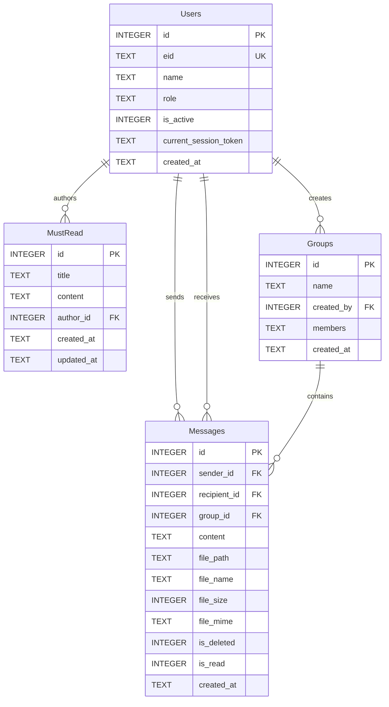

# Data Model: Internal Employee Chat System (4-Table Architecture)

## Overview
All structured relational data is stored locally in `data/chat.db` (SQLite) utilizing Write-Ahead Logging (`PRAGMA journal_mode = WAL; PRAGMA foreign_keys = ON;`). In accordance with requirements, the database is normalized into exactly **4 core tables**:

1. `Users`
2. `MustRead`
3. `Messages`
4. `Groups`

---

## Entity-Relationship Diagram



---

## DDL Schema Specifications

### 1. Table `Users`
Stores employee profiles, EID credentials, assigned role (`Admin` or `User`), and the single active session token.

```sql
CREATE TABLE IF NOT EXISTS Users (
    id INTEGER PRIMARY KEY AUTOINCREMENT,
    eid TEXT NOT NULL UNIQUE COLLATE NOCASE,
    name TEXT NOT NULL,
    role TEXT NOT NULL CHECK (role IN ('Admin', 'User')),
    is_active INTEGER NOT NULL DEFAULT 1,
    current_session_token TEXT,
    created_at TEXT NOT NULL DEFAULT (datetime('now'))
);

CREATE INDEX IF NOT EXISTS idx_users_eid ON Users(eid);
CREATE INDEX IF NOT EXISTS idx_users_name ON Users(name);
```

**Seed Data**:
```sql
INSERT OR IGNORE INTO Users (eid, name, role, is_active)
VALUES ('SuperB22', 'Super Administrator', 'Admin', 1);
```
*(Login credential: EID = `SuperB22`, Password = `Super123`)*

---

### 2. Table `MustRead`
Stores official company announcements published and managed exclusively by Admins.

```sql
CREATE TABLE IF NOT EXISTS MustRead (
    id INTEGER PRIMARY KEY AUTOINCREMENT,
    title TEXT NOT NULL,
    content TEXT NOT NULL,
    author_id INTEGER NOT NULL REFERENCES Users(id) ON DELETE CASCADE,
    created_at TEXT NOT NULL DEFAULT (datetime('now')),
    updated_at TEXT NOT NULL DEFAULT (datetime('now'))
);

CREATE INDEX IF NOT EXISTS idx_mustread_created ON MustRead(created_at DESC);
```

---

### 3. Table `Messages`
Unified message store handling both 1-on-1 Direct Messages and Group Messages, along with file attachment metadata and moderation deletion flags.

- For **Direct Messages**: `recipient_id` is set to the receiving User ID; `group_id` IS NULL.
- For **Group Messages**: `group_id` is set to the Target Group ID; `recipient_id` IS NULL.

```sql
CREATE TABLE IF NOT EXISTS Messages (
    id INTEGER PRIMARY KEY AUTOINCREMENT,
    sender_id INTEGER NOT NULL REFERENCES Users(id) ON DELETE CASCADE,
    recipient_id INTEGER REFERENCES Users(id) ON DELETE CASCADE,
    group_id INTEGER REFERENCES Groups(id) ON DELETE CASCADE,
    content TEXT,
    file_path TEXT,
    file_name TEXT,
    file_size INTEGER,
    file_mime TEXT,
    is_deleted INTEGER NOT NULL DEFAULT 0,
    is_read INTEGER NOT NULL DEFAULT 0,
    created_at TEXT NOT NULL DEFAULT (datetime('now')),
    CHECK (
        (recipient_id IS NOT NULL AND group_id IS NULL) OR 
        (group_id IS NOT NULL AND recipient_id IS NULL)
    )
);

CREATE INDEX IF NOT EXISTS idx_messages_direct ON Messages(sender_id, recipient_id, created_at);
CREATE INDEX IF NOT EXISTS idx_messages_group ON Messages(group_id, created_at);
```

---

### 4. Table `Groups`
Stores peer group conversation metadata and member lists. To maintain exactly 4 tables without an extra join table, member IDs are stored as a structured JSON array (`members`, e.g., `[1, 2, 5]`).

```sql
CREATE TABLE IF NOT EXISTS Groups (
    id INTEGER PRIMARY KEY AUTOINCREMENT,
    name TEXT NOT NULL,
    created_by INTEGER REFERENCES Users(id) ON DELETE SET NULL,
    members TEXT NOT NULL DEFAULT '[]', -- JSON array of user IDs
    created_at TEXT NOT NULL DEFAULT (datetime('now'))
);

CREATE INDEX IF NOT EXISTS idx_groups_created ON Groups(created_at DESC);
```

---

## File Attachment Storage
- Storage Directory: `data/uploads/` (managed via Multer)
- Maximum File Size: `52,428,800` bytes (50MB)
- Supported Previews:
  - Image files (`image/png`, `image/jpeg`, `image/gif`, `image/webp`): Rendered inline in chat with click-to-enlarge.
  - Other file types: Rendered as structured cards with filename, size, and download link.
